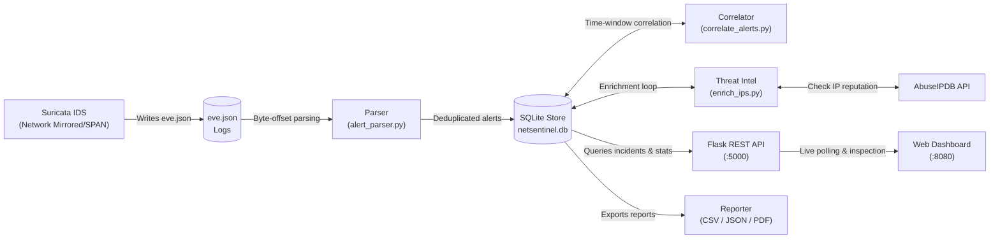

# NetSentinel

[](https://github.com/NOUFAN02/netsentinel/actions)
[](LICENSE)
[](https://www.python.org/)
[](https://suricata.io/)
[](https://flask.palletsprojects.com/)

**NetSentinel** is a lightweight, open-source security monitoring and incident response stack built around **Suricata IDS**, a **SQLite** event store, a **Flask REST API**, and an interactive real-time **web dashboard**.

It ingests Suricata alert and flow events from `eve.json`, deduplicates repeated detections with byte-offset persistence, correlates discrete alerts into coherent security incidents, enriches suspicious external IPs via threat intelligence APIs, and exports comprehensive incident reports in CSV, JSON, and PDF formats.

---

## Architecture



---

## Key Features

- **Byte-Offset Persistent Log Parsing**: Automatically tails `eve.json` and resumes from the exact last read byte offset on crash or restart without re-parsing old events.
- **Incident Correlation Engine**: Groups individual alerts sharing source/destination IP pairs within configurable sliding time windows (default 60s) into unified incidents.
- **Automated Risk Scoring**: Calculates dynamic risk levels (`High`, `Medium`, `Low`) based on alert frequency, attack severity, and rule categorization.
- **Threat Intelligence Enrichment**: Enriches external attacker IPs with AbuseIPDB reputation scores, country codes, and ISP metadata, caching results locally in SQLite to optimize API quotas.
- **Lightweight REST API**: Modular Flask endpoints for active incidents, severity distribution, protocol metrics, and top offending IP addresses.
- **Live Dark-Themed SOC Dashboard**: Chart.js data visualizations for attack trends, protocols, and severities, with drill-down modal inspection for alerts and threat intel.
- **Multi-Format Incident Reporting**: Generates automated incident reports in CSV, JSON, and publication-ready PDF formats.

---

## Project Structure

```text
NetSentinel/
├── .github/
│   ├── workflows/
│   │   └── ci.yml               # Automated multi-OS GitHub Actions CI
│   └── ISSUE_TEMPLATE/          # Bug report and feature request templates
├── api/
│   └── app.py                   # Flask REST API service
├── correlator/
│   └── correlate_alerts.py      # Incident windowing and risk correlation
├── dashboard/
│   └── index.html               # Chart.js security dashboard
├── database/
│   └── setup_db.py              # SQLite schema bootstrap and migrations
├── docs/
│   ├── monitoring_vm.md         # Lab setup and promiscuous SPAN guide
│   └── suricata/
│       └── local.rules          # Custom Suricata detection rules
├── parser/
│   └── alert_parser.py          # Suricata eve.json parser with offset tracking
├── reports/
│   ├── generate_report.py       # CSV, JSON, and PDF report generator
│   └── output/                  # Generated reports directory
├── scripts/
│   ├── start.sh                 # Linux background process startup
│   └── stop.sh                  # Process cleanup script
├── tests/                       # Automated unit and integration test suite
│   ├── test_api.py              # Flask endpoint tests
│   ├── test_correlator.py       # Incident correlation & risk scoring tests
│   ├── test_database.py         # Database schema and idempotency tests
│   ├── test_parser.py           # Parser ingestion and deduplication tests
│   └── test_reports.py          # CSV/JSON report export tests
├── .env.example                 # Environment configuration template
├── .gitignore                   # Comprehensive Git ignore rules
├── CONTRIBUTING.md              # Open source contribution guidelines
├── enrich_ips.py                # AbuseIPDB threat intelligence enrichment
├── LICENSE                      # MIT Open Source License
├── pyproject.toml               # Package metadata & build configuration
├── README.md                    # Project documentation
├── requirements.txt             # Python dependencies
├── run_pipeline.py              # Central orchestrator loop
├── start.sh                     # Stack launcher wrapper
└── stop.sh                      # Stack shutdown wrapper
```

---

## Quick Start

### 1. Prerequisites

- Python 3.10 or higher
- Suricata IDS (installed on monitoring host or reading mirrored traffic)
- (Optional) [AbuseIPDB API key](https://www.abuseipdb.com/) for external IP reputation lookups

### 2. Clone and Setup Environment

```bash
git clone https://github.com/NOUFAN02/netsentinel.git
cd netsentinel

# Create and activate virtual environment
python3 -m venv venv
source venv/bin/activate  # On Windows: .\venv\Scripts\activate

# Install dependencies
pip install -r requirements.txt
```

### 3. Configure Settings

Copy the example environment configuration:

```bash
cp .env.example .env
```

Edit `.env` to supply your configuration:

| Variable | Default | Description |
| :--- | :--- | :--- |
| `ABUSEIPDB_API_KEY` | `your_key_here` | API key from AbuseIPDB for threat intel lookups |
| `SURICATA_EVE_PATH` | `/var/log/suricata/eve.json` | Absolute path to Suricata's `eve.json` file |
| `NETSENTINEL_DB` | `netsentinel.db` | Path to SQLite database file |
| `FLASK_HOST` | `0.0.0.0` | Host interface for Flask REST API |
| `FLASK_PORT` | `5000` | Port for Flask REST API |
| `DASHBOARD_PORT` | `8080` | Port for web dashboard HTTP server |

### 4. Initialize Database

Bootstrap the SQLite tables and indexes:

```bash
python database/setup_db.py
```

### 5. Launch the Stack

#### On Linux / Production:
```bash
chmod +x start.sh stop.sh scripts/start.sh scripts/stop.sh
./start.sh
```

#### On Windows / Manual Development:
In separate terminal windows:
```bash
# 1. Start pipeline worker
python run_pipeline.py

# 2. Start Flask REST API
python api/app.py

# 3. Serve the dashboard
python -m http.server 8080 --directory dashboard
```

Open your browser at **`http://localhost:8080`** to view the live dashboard.

To stop the services on Linux:
```bash
./stop.sh
```

---

## REST API Reference

The Flask backend exposes the following endpoints on port `5000`:

| Endpoint | Method | Description |
| :--- | :--- | :--- |
| `/health` | `GET` | Service health status check |
| `/api/incidents` | `GET` | List recent security incidents (up to 200) |
| `/api/incidents/<id>` | `GET` | Retrieve details for a specific incident with associated alerts and IP intel |
| `/api/stats/severity` | `GET` | Aggregated count of alerts grouped by severity level |
| `/api/stats/top_attackers`| `GET` | Top 10 IP addresses by alert frequency |
| `/api/stats/protocols` | `GET` | Aggregated distribution of alerts by network protocol |

### Sample Incident Detail Response

```json
{
  "id": 1,
  "src_ip": "192.168.8.129",
  "dest_ip": "192.168.8.133",
  "start_time": "2026-11-06T10:14:02.000000+0000",
  "end_time": "2026-11-06T10:14:45.000000+0000",
  "alert_count": 24,
  "risk": "High",
  "status": "open",
  "alerts": [
    {
      "id": 105,
      "signature": "NETSENTINEL Possible Port Scan",
      "severity": "High",
      "proto": "TCP"
    }
  ],
  "src_intel": {
    "ip": "192.168.8.129",
    "abuse_score": null,
    "country": null,
    "isp": null
  }
}
```

---

## Generating Reports

Export incident reports across CSV, JSON, and PDF formats:

```bash
python reports/generate_report.py
```

Generated files are placed in `reports/output/`:
- `report_recent_latest.csv`
- `report_recent_latest.json`
- `report_recent_latest.pdf`

---

## Testing

Run the automated test suite with Python's built-in test runner or `pytest`:

```bash
# Using Python's standard unittest runner:
python -m unittest discover tests -v

# Or using pytest:
pytest
```

---

## Lab Architecture & Suricata Setup

For a recommended lab deployment (e.g. Kali Linux attacker vs. Ubuntu target VM), see [docs/monitoring_vm.md](docs/monitoring_vm.md) and custom detection rules in [docs/suricata/local.rules](docs/suricata/local.rules).

---

## Contributing

Contributions, bug reports, and pull requests are welcome! Please read [CONTRIBUTING.md](CONTRIBUTING.md) for details on our code of conduct and development guidelines.

---

## License

This project is licensed under the MIT License - see the [LICENSE](LICENSE) file for details.
